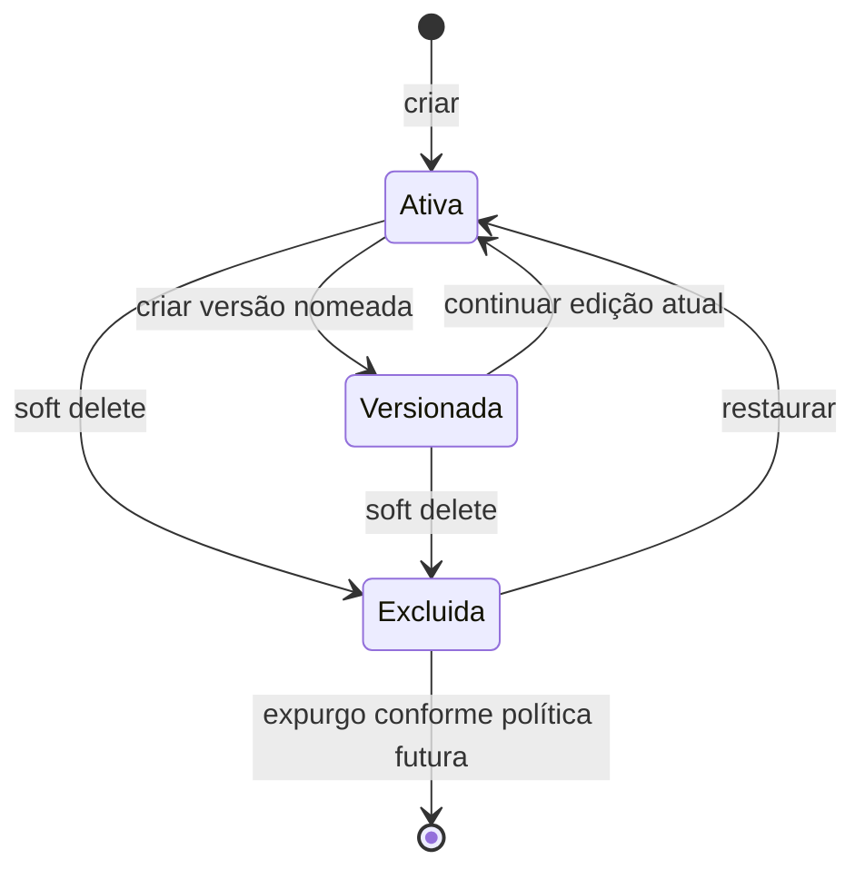
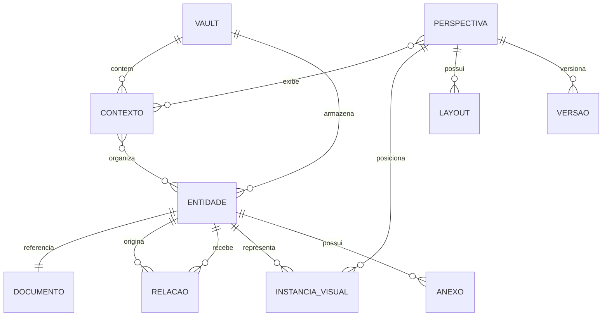
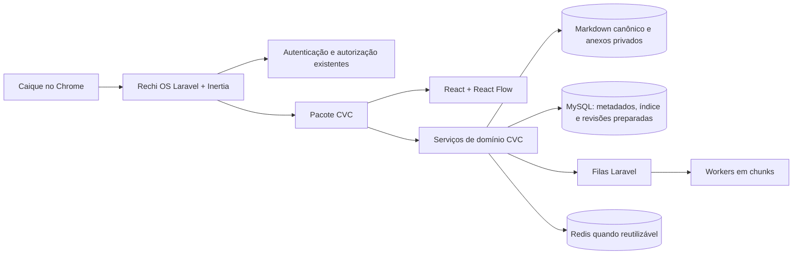
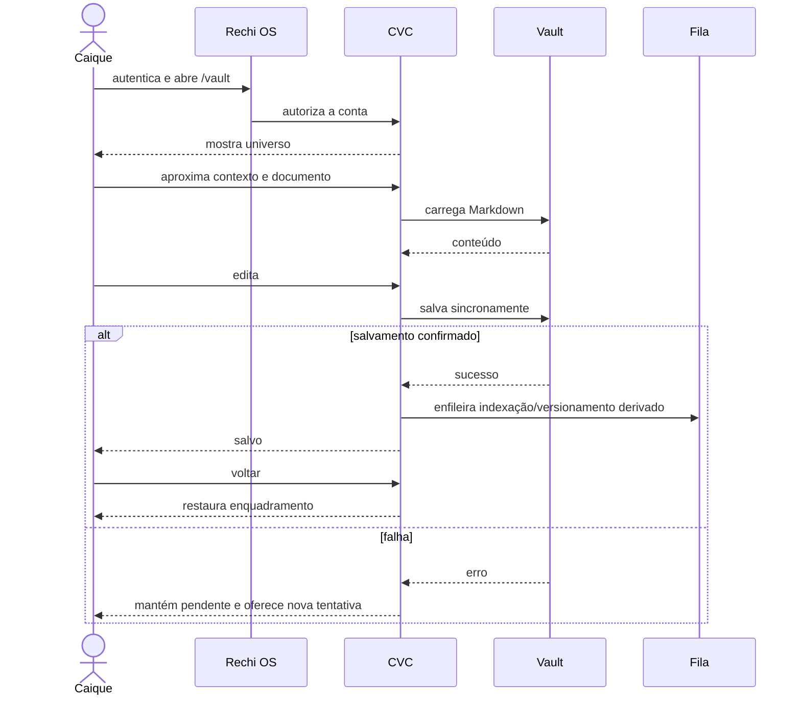
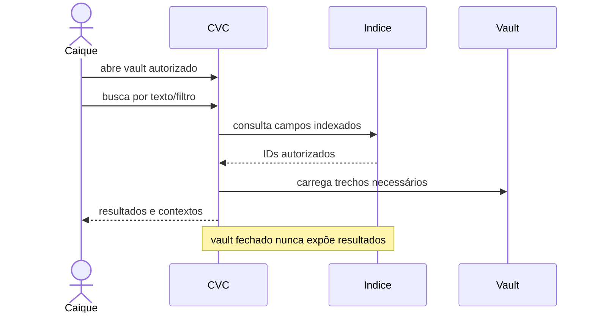
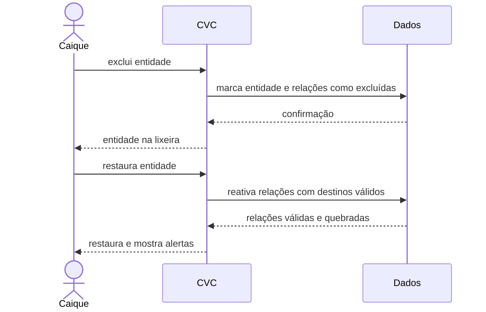

# Crow Vault Canvas — CVC

| | |
| --- | --- |
| Data | 2026-10-30 |
| Solicitante | Caique Mehret Rechi — responsável técnico, decisor e responsável pelo aceite |
| Cobertura do levantamento | 100% — 6 decisões adiadas com responsável e marco definidos |
| Status | Levantamento concluído |

## 1. Resumo

O Crow Vault Canvas (CVC) será um ambiente pessoal de conhecimento que reúne, em um único canvas, as funções de vault Markdown, grafo, diagrama e editor de documentos. O produto será entregue inicialmente como um pacote Laravel/React instalado no Rechi OS e executado localmente em Docker, com um vault físico e múltiplos universos ou contextos navegáveis por zoom semântico. A primeira entrega será uma vertical slice que percorre universo, contexto e documento editável, salva o conteúdo e retorna ao mesmo enquadramento. O MVP completo acrescentará busca, propriedades, relações, perspectivas, versões históricas, anexos seguros e soft delete.

### 1.1 Objetivos

- Substituir o espaço de conhecimento anteriormente ocupado pelo Obsidian, unificando atividades hoje separadas.
- Permitir uso como vault principal durante 30 dias sem voltar ao Obsidian para as funções cobertas pelo MVP.
- Validar os cenários essenciais de captura, navegação, edição, relações, perspectivas, recuperação e persistência.
- Abrir o vault em até 3 segundos no volume validado pela PoC.
- Confirmar salvamentos em até 300 ms em condições normais.
- Manter 60 FPS durante navegação normal no volume validado pela PoC.
- Não perder conteúdo, relações, versões ou posição após fechar e reabrir.
- Preservar segurança como bloqueador de entrega: nenhuma vulnerabilidade crítica ou alta conhecida poderá permanecer aberta.

### 1.2 Situação atual

O usuário já utilizou Obsidian para armazenar conhecimento, mas abandonou a ferramenta por desejar visualização melhor, mais opções de organização e unificação entre notas, diagramas e relações. Não há vault ou outro conjunto de dados a importar no momento. O Rechi OS já fornece a aplicação Laravel principal, autenticação, autorização, filas, Docker e infraestrutura que hospedarão o pacote CVC. O repositório `crow-vault-canvas` está vazio e será a fonte de verdade do produto.

## 2. Partes interessadas e usuários

| Persona | Quantidade | Precisa de | Pode | Não pode |
| --- | ---: | --- | --- | --- |
| Caique, usuário e responsável técnico | 1 | Capturar, organizar, relacionar, navegar, versionar e recuperar conhecimento pessoal | Administrar o vault, universos, entidades, relações, perspectivas, versões e anexos | Acessar conteúdo sem autenticação fora de `testing`; executar anexos; contornar controles de segurança |
| Usuário de teste automatizado | 1 por execução | Exercitar regras e integração sem depender de credenciais reais | Usar bypass ou identidade fixa apenas no ambiente `testing` | Existir em servidor web normal, homologação ou produção |

Caique aprova o escopo, decide questões técnicas e assina o aceite. O uso inicial ocorre no Chrome atual, em um computador pessoal, por meio do Rechi OS executado localmente em Docker. Não há outras personas, empresas ou operadores no MVP.

## 3. Modelo de negócio

O CVC é uma ferramenta pessoal, para um único usuário, sem cobrança, planos, assinatura ou centro de custo. O investimento autorizado é o tempo de Caique e os tokens disponíveis em sua assinatura do Codex. Bibliotecas, infraestrutura ou serviços pagos não podem ser adotados sem nova decisão explícita. Se o produto futuramente se tornar multiusuário ou comercial, haverá um levantamento e planejamento próprios, sem antecipar essa complexidade no MVP.

A escala de negócio é um usuário agora e no horizonte considerado. A escala técnica de notas, relações e elementos será definida por benchmark reproduzível na PoC, sob decisão de Caique, antes da aprovação do MVP.

## 4. Regras de negócio

### RN-01 — Captura progressiva

- **Regra:** uma nota pode ser criada e editada sem tipo, propriedades ou formulário obrigatório; estrutura adicional é opcional e posterior.
- **Exemplo:** um duplo clique cria “Ideia sobre autenticação” e inicia a digitação imediatamente.
- **Exceção:** propriedades obrigatórias só podem existir quando o usuário escolher explicitamente um tipo que as defina.
- **Responsável pela regra:** Caique.

### RN-02 — Identidade estável

- **Regra:** cada entidade recebe um identificador estável que sobrevive a renomes, movimentações e diferentes representações, e também ancora histórico e versões.
- **Exemplo:** renomear `jwt.md` para `tokens-jwt.md` não altera o ID nem rompe relações.
- **Exceção:** uma cópia criada explicitamente como nova entidade recebe novo ID.
- **Responsável pela regra:** Caique.

### RN-03 — Conteúdo Markdown no MVP

- **Regra:** o conteúdo textual canônico do MVP é Markdown comum armazenado em área privada do servidor local.
- **Exemplo:** editar um documento atualiza seu arquivo Markdown e mantém metadados relacionais separados quando necessário.
- **Transição aprovada:** o banco já possui estrutura aditiva para receber revisões em `LONGTEXT` com metadados JSON, hash e tamanho; arquivos continuam canônicos até migração posterior validada e reversível.
- **Exceção:** criptografia e formato próprio não fazem parte do MVP e só poderão substituir esta regra após análise específica.
- **Responsável pela regra:** Caique.

### RN-04 — Relações híbridas

- **Regra:** links Markdown representam relações simples; arquivos auxiliares abertos representam relações tipadas, direcionadas ou contextuais.
- **Exemplo:** `[[JWT]]` referencia a entidade; um sidecar registra `depends_on` no contexto `Rechi OS`.
- **Exceção:** uma relação visual entre formas livres futuras não precisa se tornar relação semântica.
- **Responsável pela regra:** Caique.

### RN-05 — Contextos não exclusivos e recursivos

- **Regra:** a mesma entidade pode participar de vários universos ou contextos sem duplicar seu conteúdo, e qualquer universo ou contexto pode conter novos contextos sem limite de profundidade imposto pela aplicação.
- **Exemplo:** `JWT` aparece em `Estudos` e `Rechi OS`, mas ambos apontam para a mesma entidade.
- **Exemplo de navegação:** cada entrada carrega apenas o nó atual e seus filhos imediatos; breadcrumbs mantêm o caminho até a raiz.
- **Exceção:** uma duplicação explícita cria outra entidade com identidade e histórico independentes.
- **Responsável pela regra:** Caique.

### RN-06 — Vault inicial único

- **Regra:** o MVP usa um vault físico fixo, preparado arquiteturalmente para múltiplos vaults futuros; dentro dele podem existir vários universos ou contextos.
- **Exemplo:** o vault contém os universos `Projetos`, `Estudos` e `Pessoal`.
- **Exceção:** múltiplos vaults físicos não serão expostos na interface do MVP.
- **Responsável pela regra:** Caique.

### RN-07 — Zoom semântico

- **Regra:** o zoom muda a representação e densidade da informação, não apenas seu tamanho; foco e edição continuam ações distintas.
- **Exemplo:** distante mostra `Projetos`, intermediário mostra `Rechi OS` e próximo mostra o documento completo.
- **Exceção:** pequenas oscilações de zoom não podem alternar repetidamente a representação; thresholds e histerese serão calibrados pela PoC.
- **Responsável pela regra:** Caique.

### RN-08 — Layout manual protegido

- **Regra:** posições e elementos fixados pelo usuário persistem; auto-layout só age por comando explícito ou em itens não fixados.
- **Exemplo:** reorganizar automaticamente um contexto preserva um documento que o usuário fixou.
- **Exceção:** o usuário pode remover a fixação e autorizar novo posicionamento.
- **Responsável pela regra:** Caique.

### RN-09 — Perspectivas independentes

- **Regra:** uma perspectiva derivada copia a configuração inicial e depois evolui independentemente.
- **Exemplo:** `Apresentação` nasce de `Arquitetura`, mas mudanças posteriores em `Arquitetura` não reorganizam `Apresentação`.
- **Exceção:** uma sincronização futura exigirá ação explícita e prévia visualização das alterações.
- **Responsável pela regra:** Caique.

### RN-10 — Versões históricas completas

- **Regra:** versões nomeadas preservam perspectiva, layout e revisões específicas do conteúdo e das relações.
- **Exemplo:** restaurar `Arquitetura v1` apresenta posições e conteúdo existentes quando a versão foi criada.
- **Exceção:** undo/redo e histórico de navegação não criam automaticamente uma versão nomeada.
- **Responsável pela regra:** Caique.

### RN-11 — Salvamento confirmado

- **Regra:** o Markdown é salvo sincronamente; a interface só mostra `salvo` após confirmação durável e mantém estados `salvando`, `salvo` e `falhou`.
- **Exemplo:** após uma pausa curta na digitação, o autosave persiste o arquivo e muda o indicador para `salvo` em até 300 ms em condições normais.
- **Exceção:** se falhar, a alteração permanece pendente, o fechamento silencioso é bloqueado e o usuário pode tentar novamente.
- **Responsável pela regra:** Caique.

### RN-12 — Processamento derivado em filas

- **Regra:** indexação, previews, snapshots e compactação de versões usam filas Laravel e processamento em chunks; a fila não substitui o salvamento canônico.
- **Exemplo:** salvar Markdown retorna após persistência; a atualização do índice é enfileirada.
- **Exceção:** uma operação pequena e necessária à consistência da transação pode permanecer síncrona.
- **Responsável pela regra:** Caique.

### RN-13 — Conflito externo conservador

- **Regra:** edição externa não é um fluxo esperado; se detectada, nenhuma versão sobrescreve a outra silenciosamente.
- **Exemplo:** um arquivo alterado fora do CVC enquanto aberto gera duas versões preservadas e pede escolha.
- **Exceção:** alterações idênticas podem ser reconhecidas sem intervenção.
- **Responsável pela regra:** Caique.

### RN-14 — Soft delete e restauração

- **Regra:** entidades e relações são excluídas logicamente; restaurar uma entidade também restaura relações cujos destinos ainda sejam válidos e alerta sobre destinos ausentes.
- **Exemplo:** excluir `JWT` move a entidade para a lixeira; restaurá-la reativa a relação com `Autenticação`.
- **Exceção:** relações para entidades permanentemente ausentes permanecem inativas e são apresentadas como quebradas.
- **Responsável pela regra:** Caique.

### RN-15 — Busca após abertura

- **Regra:** conteúdo completo, título, tags, tipo, propriedades, contexto e relações só podem ser pesquisados após o vault estar aberto e autorizado.
- **Exemplo:** uma busca por `JWT` retorna título, corpo, propriedades e contextos relacionados.
- **Exceção:** antes da abertura, a interface não expõe resultados, contagens ou trechos do índice.
- **Responsável pela regra:** Caique.

### RN-16 — Anexos restritos

- **Regra:** o MVP aceita imagens e PDFs de até 5 MB; extensão, MIME e assinatura real são validados; arquivos ficam fora da pasta pública e são servidos apenas por rota autorizada.
- **Exemplo:** um PNG válido de 2 MB é anexado e visualizado após autorização.
- **Exceção:** formato desconhecido, assinatura divergente ou arquivo acima de 5 MB é rejeitado; nenhum anexo é executado.
- **Responsável pela regra:** Caique.

### RN-17 — Autenticação e autorização

- **Regra:** o CVC reutiliza sessão e autorização do Rechi OS e fica disponível inicialmente apenas à conta de Caique.
- **Exemplo:** a rota `/vault` exige usuário autenticado e autorizado.
- **Exceção:** identidade fixa ou bypass só existe em testes automatizados no ambiente `testing`.
- **Responsável pela regra:** Caique.

### RN-18 — Segurança bloqueia entrega

- **Regra:** nenhuma vulnerabilidade crítica ou alta conhecida pode permanecer; autenticação, autorização, CSRF, XSS, path traversal, upload, segredos e dependências recebem controles e testes.
- **Exemplo:** Markdown com HTML bruto ou link `javascript:` é sanitizado ou rejeitado e não executa script.
- **Exceção:** risco residual médio ou baixo só pode ser aceito e documentado por Caique.
- **Responsável pela regra:** Caique.

### RN-19 — Isolamento do pacote

- **Regra:** falha ou desativação do CVC não pode impedir o funcionamento das demais áreas do Rechi OS.
- **Exemplo:** feature flag desativada remove `/vault` sem afetar portfólio, dashboard ou Salem.
- **Exceção:** indisponibilidade de infraestrutura compartilhada pode afetar ambos e deve ser tratada como risco da aplicação hospedeira.
- **Responsável pela regra:** Caique.

### RN-20 — Tema substituível

- **Regra:** cores e temas são definidos por variáveis e presets, nunca repetidos diretamente nas telas.
- **Exemplo:** trocar um preset altera fundo, superfícies, texto, conexões e estados sem editar componentes.
- **Exceção:** cores semânticas de segurança ou estado continuam tokens nomeados, não valores soltos.
- **Responsável pela regra:** Caique.

### RN-21 — Identidade visual

- **Regra:** o nome exibido inicialmente é CVC e a logo atual do corvo cósmico é a marca oficial provisória.
- **Exemplo:** cabeçalho e favicon usam versões adequadas da mesma identidade.
- **Exceção:** versões reduzida, monocromática e favicon podem adaptar a composição sem redesenhá-la.
- **Responsável pela regra:** Caique.

### RN-22 — Sem importação ou exportação de vault

- **Regra:** o MVP não importa nem exporta vaults.
- **Exemplo:** não existe ação para importar um vault Obsidian ou baixar todo o CVC como pacote.
- **Exceção:** anexar imagem ou PDF a uma entidade não é importação de vault.
- **Responsável pela regra:** Caique.

### 4.1 Ciclo de vida de entidade

Não existem cálculos financeiros, impostos, aprovações por terceiros ou regras fiscais. LGPD e regras comerciais não se aplicam ao MVP pessoal; conteúdo sensível continua protegido pelos requisitos de segurança.

## 5. Requisitos funcionais

### RF-01 — Abrir o vault

- **Persona:** Caique.
- **Descrição:** abrir o vault físico fixo após autenticação e autorização no Rechi OS.
- **Regras:** RN-06, RN-15, RN-17.
- **Critérios de aceite:**
  - Dado usuário não autenticado, quando acessar `/vault`, então não verá conteúdo nem índice.
  - Dado Caique autenticado, quando abrir `/vault`, então verá o universo inicial.
- **Prioridade:** Vertical slice.

### RF-02 — Navegar por zoom semântico

- **Persona:** Caique.
- **Descrição:** navegar continuamente de universo a contexto, entidade e documento sem trocar de workspace.
- **Regras:** RN-05, RN-07, RN-08.
- **Critérios de aceite:**
  - Dado o universo visível, quando aproximar um contexto, então a representação ganha detalhes sem iniciar edição.
  - Dado um enquadramento anterior, quando retornar, então posição, zoom, perspectiva e foco são restaurados.
- **Prioridade:** Vertical slice.

### RF-03 — Criar e editar documento

- **Persona:** Caique.
- **Descrição:** criar nota sem formulário, editar Markdown e salvar de forma confiável.
- **Regras:** RN-01, RN-02, RN-03, RN-11.
- **Critérios de aceite:**
  - Dado espaço vazio, quando criar uma nota, então a digitação começa sem metadados obrigatórios.
  - Dado conteúdo alterado, quando o salvamento confirmar, então reabrir mostra exatamente o conteúdo persistido.
  - Dado falha de escrita, então a interface não informa sucesso e não descarta a alteração.
- **Prioridade:** Vertical slice.

### RF-04 — Retornar ao enquadramento

- **Persona:** Caique.
- **Descrição:** voltar do documento ao mesmo ponto visual sem desfazer edições.
- **Regras:** RN-07, RN-08, RN-11.
- **Critérios de aceite:**
  - Dado documento editado e salvo, quando voltar, então o canvas restaura posição e zoom.
  - Voltar na navegação não executa undo do conteúdo.
- **Prioridade:** Vertical slice.

### RF-05 — Explorar o vault

- **Persona:** Caique.
- **Descrição:** usar painel de explorador para localizar universos, contextos e entidades.
- **Regras:** RN-05, RN-06, RN-15.
- **Critérios de aceite:**
  - O explorador mostra a estrutura autorizada sem impor propriedade exclusiva entre contextos.
  - O usuário pode criar e percorrer subassuntos em profundidade arbitrária sem carregar a árvore completa.
  - Fechar e reabrir o vault restaura o contexto ativo.
- **Prioridade:** MVP.

### RF-06 — Buscar e filtrar

- **Persona:** Caique.
- **Descrição:** pesquisar conteúdo, título, tags, tipo, propriedades, contexto e relações.
- **Regras:** RN-12, RN-15.
- **Critérios de aceite:**
  - Dado vault aberto, uma busca encontra correspondências em todos os campos aprovados.
  - Dado vault fechado, nenhuma busca ou trecho fica disponível.
- **Prioridade:** MVP.

### RF-07 — Gerir propriedades

- **Persona:** Caique.
- **Descrição:** adicionar ou alterar tipo e propriedades depois da captura inicial.
- **Regras:** RN-01, RN-02.
- **Critérios de aceite:**
  - Estruturar uma nota não altera sua identidade ou conteúdo.
- **Prioridade:** MVP.

### RF-08 — Gerir relações e contextos

- **Persona:** Caique.
- **Descrição:** criar relações livres ou tipadas, globais ou contextuais, e reutilizar entidades.
- **Regras:** RN-04, RN-05.
- **Critérios de aceite:**
  - A mesma entidade aparece em dois contextos com layouts independentes.
  - Filtrar um contexto oculta relações irrelevantes sem apagá-las.
- **Prioridade:** MVP.

### RF-09 — Gerir perspectivas

- **Persona:** Caique.
- **Descrição:** criar perspectivas manuais ou derivadas com filtros e layouts próprios.
- **Regras:** RN-08, RN-09.
- **Critérios de aceite:**
  - Alterar a perspectiva derivada não muda a origem.
  - Auto-layout não move elementos fixados sem autorização.
- **Prioridade:** MVP.

### RF-10 — Criar e restaurar versões

- **Persona:** Caique.
- **Descrição:** nomear versões históricas completas e restaurá-las.
- **Regras:** RN-02, RN-10, RN-12.
- **Critérios de aceite:**
  - Restaurar uma versão recupera layout, perspectiva e revisões específicas.
  - A restauração não apaga a versão atual sem criar ponto recuperável.
- **Prioridade:** MVP.

### RF-11 — Excluir e restaurar

- **Persona:** Caique.
- **Descrição:** aplicar soft delete e restaurar entidades e relações válidas.
- **Regras:** RN-14.
- **Critérios de aceite:**
  - Excluir remove da visão normal sem destruir imediatamente.
  - Restaurar reativa relações válidas e sinaliza relações quebradas.
- **Prioridade:** MVP.

### RF-12 — Anexar imagem ou PDF

- **Persona:** Caique.
- **Descrição:** anexar e acessar imagens e PDFs válidos de até 5 MB.
- **Regras:** RN-16, RN-17, RN-18.
- **Critérios de aceite:**
  - Arquivo permitido e válido é armazenado privadamente.
  - Arquivo desconhecido, disfarçado ou excessivo é rejeitado.
- **Prioridade:** MVP.

### RF-13 — Exibir estado operacional

- **Persona:** Caique.
- **Descrição:** mostrar salvamento, erros e tarefas em andamento dentro da interface.
- **Regras:** RN-11, RN-12.
- **Critérios de aceite:**
  - Não há e-mail, push ou canal externo no MVP.
  - Falha de fila fica visível sem afirmar conclusão.
- **Prioridade:** MVP.

### RF-14 — Integrar ao Rechi OS

- **Persona:** Caique.
- **Descrição:** instalar o pacote CVC no Rechi OS e expor `/vault` sob autenticação existente.
- **Regras:** RN-17, RN-19.
- **Critérios de aceite:**
  - O código-fonte do produto permanece em `crow-vault-canvas`.
  - Desativar a feature flag remove o CVC e preserva o Rechi OS.
- **Prioridade:** Vertical slice.

## 6. Requisitos não funcionais

| ID | Categoria | Requisito | Medida |
| --- | --- | --- | --- |
| RNF-01 | Desempenho | Abrir o vault | ≤ 3 s no volume aprovado pela PoC |
| RNF-02 | Desempenho | Confirmar salvamento normal | ≤ 300 ms |
| RNF-03 | Desempenho | Pan e zoom | 60 FPS em uso normal no volume aprovado |
| RNF-04 | Concorrência | Usuários simultâneos | 1 no MVP |
| RNF-05 | Integridade | Fechar e reabrir | zero perda de conteúdo, relações, versões e posições |
| RNF-06 | Escalabilidade | Volume máximo | benchmark reproduzível definido antes do aceite do MVP |
| RNF-07 | Segurança | Vulnerabilidades conhecidas | zero críticas ou altas abertas |
| RNF-08 | Segurança | Acesso | sessão e autorização do Rechi OS; conteúdo fora da raiz pública |
| RNF-09 | Segurança | Conteúdo | HTML bruto desativado ou sanitizado; URLs perigosas bloqueadas |
| RNF-10 | Segurança | Anexos | extensão, MIME e assinatura validados; máximo 5 MB; imagem/PDF apenas |
| RNF-11 | Segurança | Segredos | nenhum segredo no código, frontend, logs ou respostas |
| RNF-12 | Segurança | Dependências | auditorias sem vulnerabilidade crítica ou alta aceita |
| RNF-13 | Acessibilidade | Interface | meta WCAG 2.2 AA: teclado, contraste, leitor de tela e redução de movimento |
| RNF-14 | Compatibilidade | Navegador | Chrome atual |
| RNF-15 | Idioma | Interface e documentação funcional | pt-BR no MVP |
| RNF-16 | Disponibilidade | SLA | não se aplica ao MVP pessoal; manutenção pode interromper o serviço |
| RNF-17 | Isolamento | Falha do pacote | demais áreas do Rechi OS continuam operando |
| RNF-18 | Custo | Dependências e serviços | custo monetário adicional igual a zero sem nova aprovação |

Não existe meta fiscal, monetária ou multiempresa. Proteção contra bots não é necessária em escrita pública porque o CVC não possui endpoint público de criação; rate limiting e autorização continuam obrigatórios onde o host os exigir.

## 7. Modelo de domínio e dados

### 7.1 Entidades

| Entidade | Atributos principais | Origem | Volume (dia / 5 anos) |
| --- | --- | --- | --- |
| Vault | ID, nome, configuração, estado | CVC; um fixo no MVP | 1 / 1 |
| Universo/Contexto | ID, pai opcional, nome, ordem, participação de entidades | CVC | A definir pela PoC |
| Entidade | ID estável, título, tipo opcional, propriedades, tags, referência de conteúdo | CVC | A definir pela PoC |
| Documento | referência de entidade, caminho privado atual, revisão e ponteiro opcional para revisão no banco | CVC | A definir pela PoC |
| Revisão de documento | ID, entidade, revisão, formato, `LONGTEXT`, metadados JSON, hash e tamanho | CVC; preparada, ainda não canônica | A definir pela PoC |
| Relação | ID, origem, destino, tipo, direção, escopo, propriedades | Markdown/sidecar CVC | A definir pela PoC |
| Instância visual | entidade, perspectiva, contexto, representação | CVC | A definir pela PoC |
| Perspectiva | ID, nome, finalidade, filtros, contextos, versão corrente | CVC | A definir pela PoC |
| Layout | posições, dimensões, grupos, zonas, itens fixados | CVC | A definir pela PoC |
| Versão | nome, data, perspectiva, layout, revisões de entidades e relações | CVC | A definir pela PoC |
| Anexo | ID, entidade, nome, MIME, assinatura, tamanho, caminho privado | upload autorizado | A definir pela PoC; ≤ 5 MB cada |
| Trabalho derivado | tipo, estado, progresso, erro | fila Laravel | A definir pela PoC |
| Estado de workspace | perspectiva, câmera, foco e painéis | CVC | 1 por usuário/vault |

O volume máximo será adiado até a PoC, decidido por Caique por benchmark reproduzível e registrado antes do aceite do MVP.

### 7.2 Relacionamentos

### 7.3 Histórico, retenção e migração

IDs estáveis sustentam histórico e referências. Versões nomeadas registram layout, perspectiva e revisões específicas de conteúdo e relações. Soft delete se aplica a entidades e relações. A política de retenção e expurgo será definida por Caique depois da PoC e antes do aceite do MVP.

Não há dados a migrar. Importação e exportação de vaults não fazem parte do escopo. Backups já são mantidos por Caique localmente e na Hostinger; o MVP não implementará outro sistema de backup. Criptografia, gestão de chaves e recuperação são adiadas para análise específica após o MVP e antes de qualquer hospedagem remota.

## 8. Arquitetura

### 8.1 Visão geral

O CVC é um módulo/pacote do monólito Rechi OS, mas seu código-fonte e documentação pertencem ao repositório `crow-vault-canvas`. O Rechi OS mantém a configuração principal do Laravel, Docker, autenticação, autorização, banco, cache e filas. O pacote registra sua área `/vault`, componentes, serviços e recursos sem acoplar o restante da aplicação ao seu funcionamento.

No navegador ficam interação, câmera, seleção, estado visual e renderização. No servidor ficam autorização, validação, salvamento canônico, regras, acesso a arquivos, histórico e trabalhos pesados. React Flow é apenas adaptador visual: o domínio não usa seu modelo como fonte de verdade.

### 8.2 Tecnologias

| Camada | Tecnologia | Motivo |
| --- | --- | --- |
| Aplicação hospedeira | Laravel 13 / PHP 8.3+ | stack já definida no Rechi OS |
| Navegação web | Inertia 3 | integração existente entre Laravel e React |
| Interface | React 19 / TypeScript | stack existente e nós customizados |
| Canvas inicial | React Flow | MIT, React nativo, nós e conexões customizáveis |
| Estilo | Tailwind CSS 4 e variáveis/presets CSS | stack existente e tema substituível |
| Build | Vite 8 | stack existente |
| Persistência relacional | MySQL existente | metadados, histórico, índice, filas e estrutura de revisão preparada conforme arquitetura do host |
| Conteúdo atual | Markdown e arquivos privados | conteúdo canônico portátil durante a transição |
| Conteúdo preparado | `LONGTEXT` + JSON no MySQL | migração futura incremental, verificável e reversível |
| Cache e filas | Redis / filas Laravel | tarefas derivadas, chunks e reutilização segura |
| Ambiente | Docker do Rechi OS | host local aprovado |
| Testes | PHPUnit e ferramentas TypeScript já existentes | evitar nova tecnologia sem aprovação |

tldraw foi descartado para o MVP por exigir licença de produção e criar risco de custo/dependência. Motor totalmente customizado foi descartado pelo prazo e custo de implementação. Qualquer tecnologia adicional exige opções, justificativa e aprovação de Caique.

### 8.3 Integrações

| Sistema | Direção | Gatilho | Contrato | Se falhar |
| --- | --- | --- | --- | --- |
| Rechi OS | host → CVC | acesso a `/vault` | pacote Laravel/React, sessão, autorização, feature flag | CVC indisponível; restante do Rechi OS continua |
| Filesystem privado | CVC ↔ arquivos | criar, salvar, versionar, anexar | Markdown permanece canônico; caminhos validados e confinados à raiz do vault | alteração fica pendente; erro visível; nenhum sucesso falso |
| MySQL | CVC ↔ banco | metadados, histórico, busca e revisões preparadas | migrations reversíveis; conteúdo no banco ainda não participa do fluxo canônico | transação falha e operação não é confirmada |
| Redis/fila | CVC → workers | indexar, gerar preview/snapshot, compactar | jobs idempotentes em chunks | erro registrado e visível; salvamento canônico permanece válido |

Não existem APIs externas, e-mail, push, cobrança ou integrações governamentais no MVP. As credenciais pertencem ao Rechi OS e nunca são expostas ao frontend.

### 8.4 Multiempresa, ambientes e deploy

Não se aplica multiempresa: um usuário e um vault físico no MVP. A arquitetura admite múltiplos vaults futuros, sem interface ou contrato definido agora.

Ambientes:

- `testing`: identidade fixa/bypass restrito a testes automatizados.
- desenvolvimento local: Rechi OS em Docker com pacote CVC local.
- produção remota: fora do MVP.

Não haverá implantação na Hostinger antes de revisão específica de segurança, persistência e integração. CI no repositório CVC fica para depois do MVP. Uma versão local é revertida removendo/desativando o pacote por feature flag e restaurando código/migrations conforme procedimento do host.

## 9. Fluxos principais

### 9.1 Vertical slice de navegação e edição

### 9.2 Busca autorizada

### 9.3 Soft delete e restauração

## 10. Gargalos, riscos e mitigações

| Risco | Onde | Probabilidade | Impacto | Mitigação |
| --- | --- | --- | --- | --- |
| React Flow limitar whiteboard ou zoom semântico | canvas | Média | Alto | adaptador próprio, PoC, domínio independente e possibilidade de substituição |
| Renderização degradar em grafos grandes | navegador | Alta sem limite | Alto | benchmark, LOD, viewport culling, carregamento incremental e volumes aprovados |
| Indexação/versionamento bloquear salvamento | servidor | Média | Alto | salvamento síncrono mínimo; tarefas derivadas em filas e chunks |
| Conteúdo Markdown causar XSS | renderização | Média | Crítico | HTML bruto desativado/sanitizado, protocolos permitidos e testes |
| Path traversal acessar arquivo fora do vault | filesystem | Média | Crítico | normalização, raiz confinada, autorização e testes adversariais |
| Upload disfarçado ou ativo | anexos | Média | Alto | extensão + MIME + assinatura, 5 MB, tipos permitidos e armazenamento privado |
| Pacote derrubar Rechi OS | integração | Baixa | Alto | feature flag, rotas e providers isolados, tratamento de falhas |
| Perda de dados em salvamento/versão | persistência | Baixa | Crítico | confirmação durável, transações, testes de reabertura e backups existentes |
| Política de retenção indefinida | soft delete | Alta até decisão | Médio | decisão obrigatória após PoC e antes do aceite do MVP |
| Hospedagem remota prematura | deploy | Baixa | Crítico | proibida até revisão específica |
| Dependência de uma pessoa | operação | Certa | Médio | documentação completa, formato aberto e testes básicos honestos |

Não há picos de usuários concorrentes no MVP. As operações pesadas previstas são busca, indexação, preview e compactação de versões; todas devem suportar chunks e progresso visível.

## 11. Escopo e fases

- **Vertical slice/PoC prioritária:** RF-01, RF-02, RF-03, RF-04 e integração mínima de RF-14. Meta desejada até segunda-feira, sem compromisso rígido.
- **MVP completo:** RF-05 a RF-13 e conclusão segura de RF-14, além dos RNFs aplicáveis.
- **Fase posterior:** ferramentas de desenho livre, minimapa e histórico visual completos, múltiplos vaults físicos, CI do repositório, implantação remota e possíveis novos motores de canvas.
- **Análise separada obrigatória:** criptografia, gestão de chaves, recuperação e eventual formato protegido, antes de implementação ou hospedagem remota.
- **Fora do escopo:** colaboração em tempo real, IA embutida, marketplace, automações complexas, sincronização em nuvem, cobrança, multiempresa, importação/exportação de vault e suporte a arquivos desconhecidos.

## 12. Engenharia e operação

A equipe é Caique com auxílio do Codex. Caique desenvolve, mantém, decide e aceita. O código-fonte fica em `CaiqueRechi/crow-vault-canvas`; a aplicação hospedeira permanece em `CaiqueRechi/rechi-os`. Valem as convenções `crow`: branch no padrão `cm-{tarefa}` a partir de `origin/main`, Clean Code/SOLID, um commit por mudança, commits em inglês, documentação em commit próprio, testes, verificação de segurança, sem coautoria e sem push pelo agente.

O MVP exige testes unitários e de integração para identidade, salvamento, histórico, relações, autorização, sanitização, path traversal, anexos, soft delete e isolamento do pacote. Teste de navegador e CI ficam para depois do MVP. A qualidade mínima é honesta: nenhum fluxo crítico pode ser declarado funcional sem teste correspondente e execução bem-sucedida.

A documentação de requisitos e arquitetura fica em `crow-vault-canvas/docs/`. O Rechi OS recebe apenas instalação, configuração, feature flag e contrato de integração.

Operação inicial:

- logs Laravel, health check e visibilidade de falhas nas filas;
- backups locais e Hostinger já administrados por Caique; não há novo sistema no MVP;
- suporte, treinamento e rollout formal não se aplicam porque há um usuário;
- manutenção pode causar indisponibilidade sem SLA;
- produção remota é proibida até revisão.

## 13. Restrições

- Custo monetário adicional: zero.
- Recursos disponíveis: tempo de Caique e tokens do Codex incluídos na assinatura.
- Meta desejada para a vertical slice: até segunda-feira, sem prazo obrigatório.
- MVP completo: sem prazo fixo.
- Navegador: Chrome atual.
- Stack principal e configuração Laravel permanecem no Rechi OS.
- Tecnologia nova exige consulta prévia com opções e trade-offs.
- Não implantar remotamente durante o MVP.
- Logo oficial provisória disponível em `C:/Users/caique.mehret/Downloads/Corvo Cósmico em Espiral Galáctica.png`; o desenvolvimento deve copiá-la para o local versionado apropriado e derivar favicon/versões reduzida e monocromática.
- Paleta livre, mas todos os valores devem ser tokens/variáveis em presets substituíveis.

## 14. Aceite

Caique assina o aceite com base em testes executados, demonstração dos fluxos e ausência de vulnerabilidades críticas ou altas conhecidas.

Vertical slice aceita quando:

1. Caique autentica no Rechi OS e abre `/vault`.
2. Navega de universo para contexto e documento por zoom contínuo.
3. Edita Markdown e vê confirmação de salvamento.
4. Fecha/reabre ou retorna ao canvas sem perder conteúdo nem enquadramento.
5. Falha simulada de escrita mantém o conteúdo pendente e não mostra sucesso falso.
6. Testes unitários e de integração relacionados passam.

MVP aceita quando:

1. Os dez cenários essenciais da especificação v1.3 aplicáveis ao escopo passam.
2. Busca cobre conteúdo, título, tags, tipo, propriedades, contextos e relações.
3. Entidade compartilhada mantém identidade e layouts independentes.
4. Perspectiva derivada evolui independentemente.
5. Versão nomeada restaura conteúdo, relações, perspectiva e layout históricos.
6. Soft delete e restauração preservam relações válidas e alertam sobre ausentes.
7. Imagens/PDF válidos de até 5 MB funcionam; arquivos inválidos são rejeitados.
8. Metas de 3 s, 300 ms e 60 FPS passam no volume definido pela PoC.
9. Reabrir demonstra zero perda de dados.
10. O CVC pode ser desativado sem derrubar o Rechi OS.
11. Caique utiliza o CVC como vault principal por 30 dias sem voltar ao Obsidian para funções cobertas.

Dados de teste iniciais serão fictícios e incluirão um universo, dois contextos compartilhando uma entidade, relações globais/contextuais, duas perspectivas e pelo menos uma versão histórica.

## 15. Decisões em aberto

| # | Decisão | Área | Responsável | Prazo | Impacto se atrasar |
| --- | --- | --- | --- | --- | --- |
| DA-01 | Volumes máximos de notas, relações e elementos | Desempenho | Caique | Após PoC, antes do aceite do MVP | impede validar escalabilidade e RNF-01/RNF-03 |
| DA-02 | Thresholds e histerese do zoom semântico | UX/desempenho | Caique | Durante a PoC | pode causar oscilação ou densidade inadequada |
| DA-03 | Política de retenção e expurgo do soft delete | Dados | Caique | Após PoC, antes do aceite do MVP | impede finalizar ciclo de vida e armazenamento |
| DA-04 | Estratégia de criptografia, chaves e recuperação | Segurança | Caique | Depois do MVP e antes de implementação remota | impede hospedagem remota segura |
| DA-05 | Pipeline de CI do repositório CVC | Engenharia | Caique | Depois do MVP | verificações dependem de execução local |
| DA-06 | Implantação na Hostinger e rollback | Operação | Caique | Após revisão de segurança e persistência | produção remota permanece proibida |

Todas as decisões estão adiadas explicitamente e têm Caique como responsável. Nenhuma bloqueia a vertical slice local; DA-01, DA-02 e DA-03 bloqueiam o aceite do MVP completo.

## 16. Glossário

| Termo | Significado |
| --- | --- |
| CVC | Crow Vault Canvas |
| Vault | Contêiner físico de conhecimento; um fixo no MVP |
| Universo | Região ampla navegável dentro do vault |
| Contexto | Recorte semântico não exclusivo de entidades e relações |
| Entidade | Item de conhecimento com identidade estável |
| Documento | Conteúdo Markdown associado a uma entidade |
| Relação | Vínculo livre ou tipado, global ou contextual |
| Perspectiva | Visão configurada com filtros, contextos e layout |
| Layout | Estado espacial de uma perspectiva |
| Instância visual | Representação situada de uma entidade compartilhada |
| Versão | Revisão nomeada de conteúdo, relações, perspectiva e layout |
| Zoom semântico | Mudança de representação e densidade conforme escala e contexto |
| LOD | Level of Detail; simplificação conforme zoom e relevância |
| Soft delete | Exclusão lógica recuperável antes de expurgo |
| Vertical slice | Percurso mínimo completo entre interface, domínio e persistência |
| Sidecar | Arquivo auxiliar aberto que guarda metadados relacionais ou visuais |
| Feature flag | Configuração que ativa ou desativa o pacote sem afetar o host |
